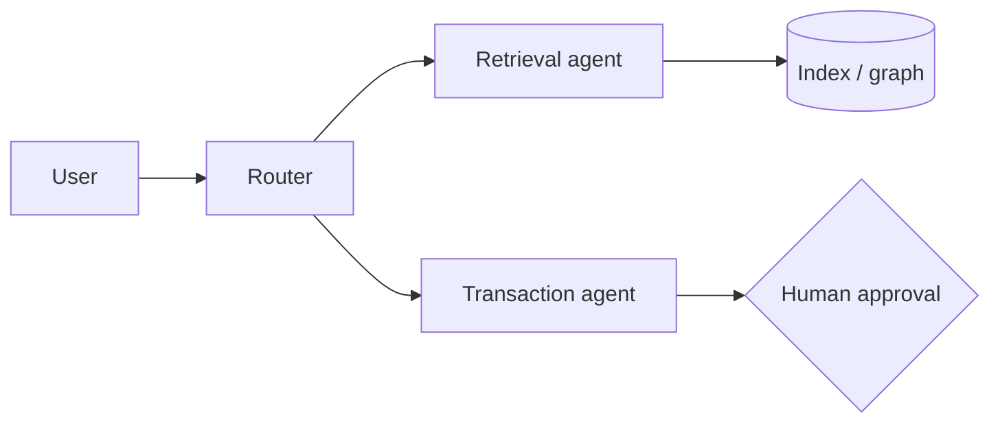

# Architecture - <system name>
## Context
Business process, users, systems touched.
## Diagram

## Components and why
## Data flow and where PII is touched
## Failure modes and mitigations
## Decisions and alternatives rejected
